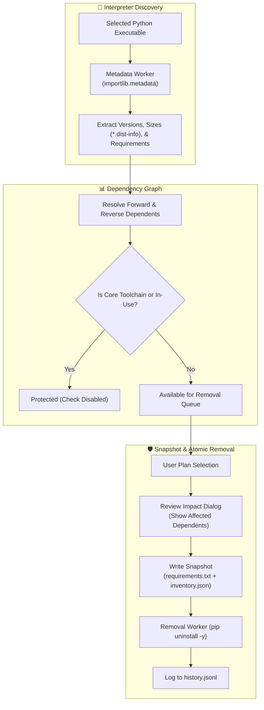

# 📦 Python Package Uninstaller — PyQt6 Environment Package Manager

<div align="center">

[](https://www.python.org/)
[](https://www.riverbankcomputing.com/software/pyqt/)
[](#-verification--tests)
[](package_backend.py)
[](#-recovery--snapshots)
[](package_uninstaller.py)
[](LICENSE)

**A local, high-precision desktop application built with PyQt6 for inspecting Python virtual environments, calculating true installed package sizes, analyzing reverse dependency impact, and executing safe, reversible uninstalls.**

<p align="center">
  
</p>

[Quick Start](#-quick-start) • [UI Highlights](#-interface-previews) • [Safety & Dependency Engine](#-safety--dependency-analysis) • [Recovery](#-recovery--snapshots) • [Testing](#-verification--tests)

</div>

---

## ⚡ Key Features

- **🔍 Exact Disk Space Calculation**: Measures installed distribution sizes by analyzing recorded file manifests in `.dist-info` / `.egg-info` rather than blindly guessing from shared directories.
- **🛡️ Reverse Dependency Warning**: Analyzes target environment markers, extras, and dependent packages. Warns you before removing packages required by other installed distributions.
- **🔒 Protection for Core Toolchains**: Locks and prevents accidental deletion of `pip`, `setuptools`, `wheel`, and active GUI runtime dependencies.
- **📸 Pre-Removal Snapshots**: Automatically writes a timestamped snapshot (`requirements.txt` and `inventory.json`) before executing pip uninstalls.
- **📑 Responsive Paginated Grid**: Obsidian-themed compact 26px rows, automatic window-fitting pagination, multi-page selection retention, and instant search.
- **🛑 Non-Blocking Queue with Interruption**: Asynchronous worker thread with **Stop after current** cancellation support.

---

## 📸 Interface Previews

<div align="center">

### Review Removal Dialog with Reverse Dependency Warnings


### Compact View with Responsive Auto-Rows


</div>

---

## 🏗️ Architecture & Execution Flow



---

## 🚀 Quick Start

### Prerequisites
- Python **3.10+** (Python 3.10, 3.11, 3.12, 3.13, 3.14 supported).
- The inspected target interpreter only requires Python 3.10+ (does not require PyQt6).

### 1. Installation
```powershell
# Clone the repository
git clone https://github.com/Rahim36712/python-package-uninstaller.git
cd python-package-uninstaller

# Install PyQt6 and packaging
pip install -r requirements.txt
```

### 2. Launch Application
```powershell
python package_uninstaller.py
```

---

## 🛡️ Safety & Dependency Analysis

- **Installed Sizes**: Computes each package's actual recorded files. Inaccessible files are indicated with `*`; editable source links are marked with `†`.
- **Environment Isolation**: Inherited base packages outside an active virtual environment and Conda-managed non-pip packages are protected from modification.
- **Topological Uninstall Order**: When multiple interdependent packages are chosen, dependents are uninstalled before their upstream dependencies.
- **Safe Rendering**: All metadata and terminal logs are rendered strictly as plain text to prevent rich-text injection attacks.

---

## 📸 Recovery & Snapshots

Before any batch removal commences, the application generates a recovery bundle under:
```
%LOCALAPPDATA%\LocalTools\PythonPackageUninstaller\
```
Containing:
1. `requirements.txt`: Clean output of `pip freeze --all`.
2. `inventory.json`: Full metadata snapshot of package versions, installer sources, and dependencies.

### Reinstalling from Snapshot
To restore the environment back to the state recorded prior to an uninstall operation:
```powershell
& 'C:\path\to\python.exe' -m pip install -r 'C:\path\to\snapshot\requirements.txt'
```

---

## 🧪 Verification & Tests

```powershell
# Run the 36 automated unit and isolation tests
python -m unittest discover -s tests -v
```

The test suite validates:
- Size aggregation and recorded file accounting
- Dependency graph cycle resolution
- Marker evaluation and optional extra rules
- Isolated virtual environment mock pip lifecycle
- Busy-state window locks and cancellation hooks

---

## 📁 Repository Structure

```
python-package-uninstaller/
├── package_backend.py        # Metadata scanner, dependency resolver & snapshot manager
├── package_uninstaller.py    # PyQt6 desktop GUI, worker threads & event handlers
├── assets/                   # Checkmark and chevron vector SVG assets
├── verification/             # High-resolution application screenshots
├── tests/                    # 36 Unit, integration, and UI test suites
│   ├── test_backend.py
│   ├── test_integration.py
│   ├── test_ui.py
│   └── verify_runtime.py
├── requirements.txt          # Dependencies (PyQt6, packaging)
└── README.md                 # Project documentation
```

---

<div align="center">
  <sub>Engineered for clean environments, transparent dependencies, and zero accidental deletions.</sub>
</div>
